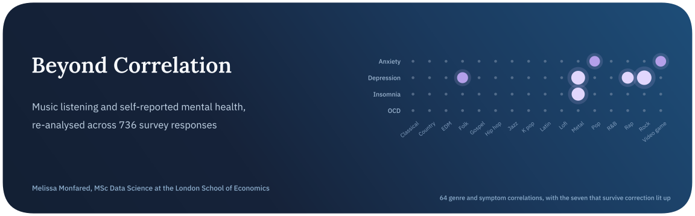
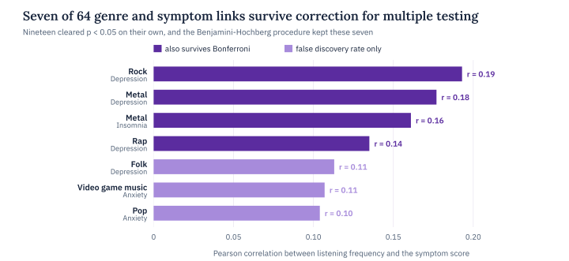
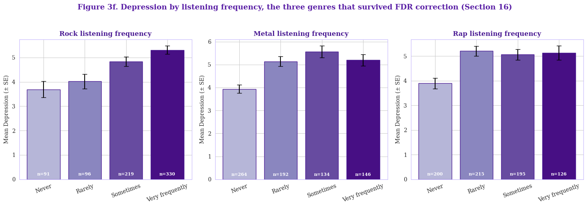
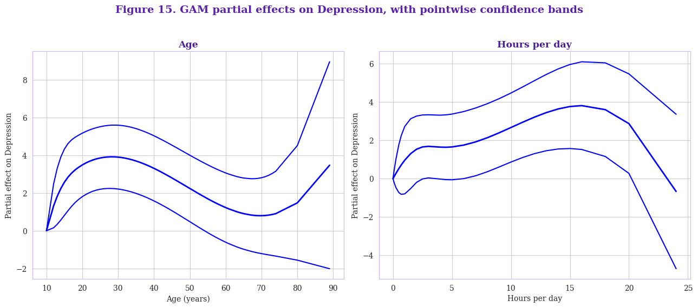
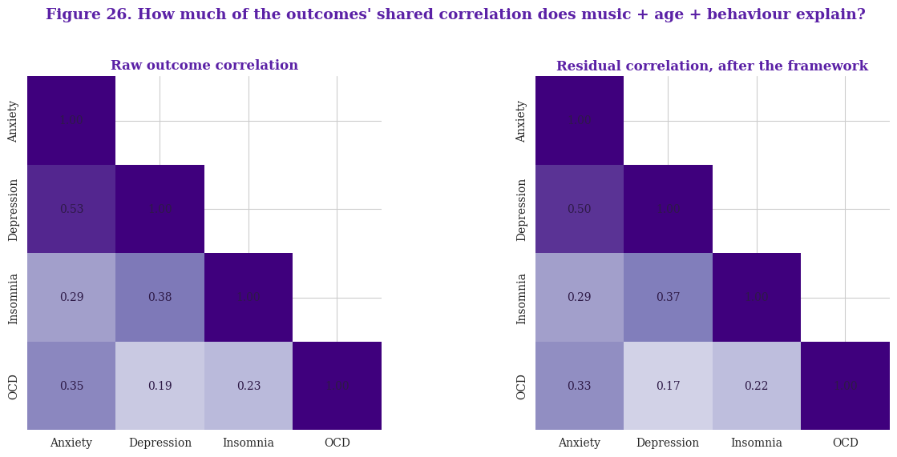
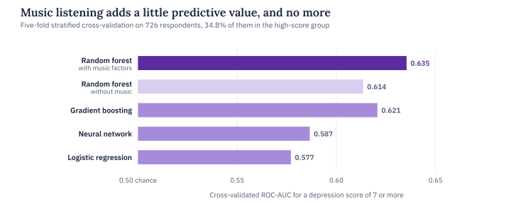

<p align="center">
  
</p>

<p align="center">
  
  
  
  
</p>

The Music and Mental Health survey has been analysed publicly many times. Most of those analyses build a correlation heatmap and a bar chart per genre, then read the patterns as evidence about what music does to the people who listen to it. This project re-analyses the same 736 responses with a different standard of evidence, where every association has to show its size and survive a correction for the number of tests behind it.

The four outcomes are self-rated anxiety, depression, insomnia and OCD symptoms on a 0 to 10 scale, and they are modelled together as well as one at a time. Each finding is rechecked under alternative specifications and with the most influential respondents removed, and the notebook is explicit throughout about what a single cross-sectional survey can and can’t establish.

> **In short.** Listening to rock and metal goes with modestly higher depression scores, and that link survives correction across 64 genre-by-symptom tests and still shows up with every other genre in the model. It is a small effect, with a correlation of about 0.19, and music information lifts the prediction of high depression scores only slightly. Nothing in a one-off survey can say whether the music shapes the mood or the mood shapes the music.

## Key findings

| Finding | Evidence |
| :-- | :-- |
| Most genre links don’t survive correction | 19 of 64 genre-by-symptom correlations clear p < 0.05 on their own, 7 survive the Benjamini-Hochberg correction and 4 survive Bonferroni |
| Rock and metal lead the survivors | The four Bonferroni survivors are rock with depression (r = 0.19), metal with depression (0.18), metal with insomnia (0.16) and rap with depression (0.14) |
| They hold up with every genre in the model | With all sixteen genres, age and listening habits in one regression, each step up in rock listening adds 0.35 points of depression (p = 0.014) and each step in metal 0.26 (p = 0.034) |
| A penalised model picks the same genres | The lasso keeps 9 of 17 predictors for depression, and its four largest coefficients are rock (0.33), metal (0.23), rap (0.22) and age (−0.22) |
| Age is not a straight line | Splines for age and daily listening hours fit depression far better than straight lines (F(7, 725) = 5.66, p < 0.0001), with depression peaking in the mid to late twenties |
| Music says little about the shared core of the symptoms | The four outcomes correlate from 0.20 to 0.52, and after modelling music, age and behaviour every one of those correlations moves by 0.03 or less |
| Music adds a little to prediction | A random forest reaches a cross-validated ROC-AUC of 0.635 for a depression score of 7 or more, against 0.614 without the music variables |

<picture>
  <source media="(prefers-color-scheme: dark)" srcset="assets/fdr-dark.svg">
  
</picture>

## Conclusion

One association holds up under everything the notebook throws at it. People who listen to more rock and metal report higher depression scores, a pattern visible in the raw group means, surviving correction across 64 tests, persisting with every other genre in the model and given the largest coefficient by the lasso. Its size deserves as much attention as its significance. A correlation of 0.19 means listening frequency accounts for under 4% of the variation in depression scores.

Most of what looks interesting in a heatmap of this survey doesn’t survive. Twelve of the nineteen nominally significant genre links fall away once the number of tests is accounted for, and music variables barely move the prediction of high depression scores. The most flexible model in the comparison, a small neural network, never matched a random forest. The four symptoms share a good deal of variance with one another, but almost none of that shared core is explained by what people listen to.

The design sets a hard ceiling on interpretation. The survey can’t tell whether rock and metal listening raises depression scores or whether people who already feel low gravitate toward heavier music. Unmeasured traits such as personality or life stress could also drive both. The survey’s own question on whether music helps, where 74% said it improves their mental health, records the respondent’s belief at the same sitting as the symptom scores, so the notebook doesn’t treat it as evidence either way.

## The data

The data is the MxMH survey from Kaggle, 736 responses to an online questionnaire. Each respondent rated how often they listen to sixteen genres on a four-point scale from never to very frequently, and rated their own anxiety, depression, insomnia and OCD symptoms from 0 to 10. The survey also records age, daily listening hours, the tempo of their favourite music and a handful of listening habits, such as whether they play an instrument or listen while working.

Every cleaning decision is stated before it touches a model. Eight tempo values that can’t describe real music, including 0 and 999,999,999 BPM, are set to missing. Respondents reporting 24 hours of daily listening or unusual ages are kept, since excluding people on the strength of their scores would bias the result, and the sensitivity checks refit the models without them. The primary models use the 726 respondents with complete covariates.



*Mean depression by listening frequency, before any model. Rock rises step by step, from 3.69 among people who never listen to 5.31 among very frequent listeners, while metal and rap jump between never and any regular listening and then level off.*

## Methods

| Question | Method | Result |
| :-- | :-- | :-- |
| Are the four symptoms one thing? | Pairwise correlations with Fisher intervals | Related but distinct, from r = 0.20 for depression and OCD to 0.52 for anxiety and depression |
| Can sixteen genres be reduced to a few dimensions? | Kaiser-Meyer-Olkin and Bartlett checks, then factor analysis with an oblique rotation | Factorable at KMO 0.71, with four components explaining 52.5% of the variance |
| Which genre links survive multiple testing? | 64 Pearson correlations with Benjamini-Hochberg and Bonferroni corrections | 7 survive the false discovery rate and 4 survive Bonferroni |
| Do they survive adjustment for the other genres? | Least squares with HC1 standard errors and every genre in the same model, adjusted for age and listening habits | Rock at 0.35 points per frequency step and metal at 0.26 |
| Which genres carry signal when all compete? | Penalised regression tuned by cross-validation | The lasso keeps rock, metal, rap and folk, plus a negative coefficient for country |
| Are age and listening hours linear? | Generalised additive model against the linear model, nested F-test | Clearly nonlinear, though the curves rest on few respondents at the extremes |
| Can music predict a high depression score? | Logistic regression, random forest, gradient boosting and a small neural network under five-fold stratified cross-validation | Best ROC-AUC of 0.635, up from 0.614 without music |
| How much of the symptoms’ shared variance is explained? | Four outcome models with smooth age terms, compared on their residual correlations | Every pairwise correlation moves by 0.03 or less |

The factor-level models, which use the four listening dimensions in place of raw genres, are being re-estimated after a correction to the rotation step, and their results will be added here once that run is finished.



*Partial effects of age and daily listening hours on depression. The rise into the mid to late twenties is well supported, while the turns at the oldest ages and the longest listening hours rest on only a handful of respondents.*



*The outcomes’ correlations before and after modelling music, age and behaviour. The two panels are almost identical, so whatever ties the four symptoms together lies outside what this survey measures.*

<picture>
  <source media="(prefers-color-scheme: dark)" srcset="assets/predict-dark.svg">
  
</picture>

## Limitations and next steps

The survey is cross-sectional and self-reported, so every result here is an association, and the symptom scores are single self-ratings rather than validated scales such as the PHQ-9. Respondents chose to take an online survey about music and mental health and skew young, with a median age of 21. The analysis was also built and refined on the same data it reports, so even with pre-specified hypotheses it can’t claim the discipline of a pre-registered study.

Separating the causal stories would take repeated measurements of the same people over time, ideally with validated clinical scales in place of single items.

## Running it

The notebook reads the `mxmh_survey_results.csv` file from the Kaggle MxMH dataset and runs top to bottom on a standard Kaggle CPU session. One optional cell compares genre names using a pretrained sentence-embedding model and skips itself cleanly if that package isn’t available.

```bash
pip install numpy pandas scipy statsmodels scikit-learn matplotlib seaborn tensorflow
jupyter notebook beyond-correlation-music-mental-health-analysis.ipynb
```

## Repository

```text
.
├── beyond-correlation-music-mental-health-analysis.ipynb   the full analysis, from data quality to causal reasoning
├── mental-health-music-relationship-analysis-eda.ipynb     the earlier exploratory notebook this analysis revisits
├── assets/                                                  figures used in this README
└── README.md
```

## About

Made by Melissa Monfared, MSc Data Science at the London School of Economics. More projects live on [my website](https://melissamonfared.github.io). I also post notebooks on [Kaggle](https://kaggle.com/melissamonfared) and I’m on [LinkedIn](https://linkedin.com/in/melissamonfared).

Survey data from the MxMH project, distributed on Kaggle.
